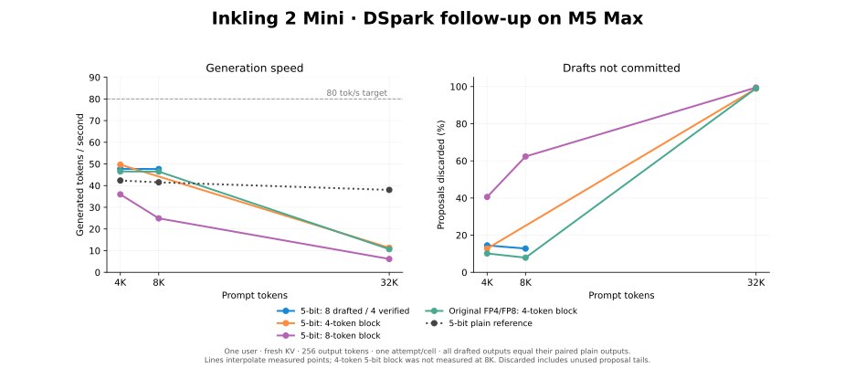

# Inkling 2 Mini speed and draft rejection

Measured on November 20, 2026, on Apple M5 Max with 64 GiB RAM, macOS 27.0.1,
MLX 0.32.4 and MLX-LM `0c4c99192230f1943dd468d297f0b8a64ae7b7c2`.
Serving/benchmark source baseline: TensorFold `4ed91e5960e614d761d4b7c55107ed4c60b63e79`.

One user, fresh KV, greedy decoding, 256 output tokens, one attempt per cell.
Prompts are deterministic synthetic token arrays, not a quality evaluation or
representative rejection estimate for all user conversations. All 12 drafted
outputs matched their paired plain outputs token for token. The retained
[results](dspark-followup.json) include token hashes and timings. Results on
this chip do not qualify other platforms, sampled generation, images, or
concurrent drafted requests.

## What the graph means

- The best 5-bit trial at 4K measured **49.7 tok/s**, versus its paired plain
  **42.7 tok/s**. Its four-token block used BF16 draft projections.
- Generating eight draft positions but verifying at most four measured
  **47.8 tok/s at 4K** and **47.7 tok/s at 8K**.
- Four-token drafting at 32K fell to **11.3 tok/s**, versus **35.9 tok/s**
  plain. About **98.9%** of proposals were discarded.
- The original NVFP4/MXFP8 checkpoint did not improve on the best 5-bit rates.
- The dotted plain curve is the paired baseline from the eight-token 5-bit
  trial. Each candidate's own paired baseline is retained in the JSON; small
  differences between runs are expected with one attempt per cell.
- Discard rate is `100 * (proposed - accepted) / proposed`. This includes
  unverified suffixes discarded after the first mismatch, not just tokens
  individually rejected by the verifier. Missing measurements are not zero;
  chart lines connect measured points.

No variant reached 80 tok/s. **DSpark remains disabled in the API** because
these probes do not establish a reliable speed improvement across contexts.
Ordinary serving measured roughly 39–43 tok/s solo and 19–21 tok/s per user
with two active text requests in the separate
[serving receipt](../../tools/inkling/receipts/mlx-5bit-m5max.json).

## Checkpoints and method

- Target: [Inkling 2 Mini MLX 5-bit](https://huggingface.co/araysuter/Inkling-2-Mini-MLX-5bit),
  revision `4e7ff0e11667a88bae9a7a9323e93d498899aa8b`.
- Original target and `mtp.safetensors` draft:
  [thinkingmachines/Inkling-2-Mini](https://huggingface.co/thinkingmachines/Inkling-2-Mini),
  revision `6e7c8248f75265bdd4fbab5273304243b5d8c2cb`.
- [Standalone DSpark tool and reproduction instructions](../../tools/inkling/DSpark.md).
  Four-token trials use `--width 4 --draft-bits 16` or `8`. The eight-token
  exploratory copy extends the width choices to eight. The narrower-verifier
  copy proposes eight positions and keeps only the first `width - 1` guesses.
  These trial-only changes are not API settings or qualified serving options.
- [Hugging Face release article](https://huggingface.co/blog/inkling2mini): its
  speculative performance measurements use an NVIDIA B300 with different
  request lengths and repetitions, not this Mac.

To redraw the chart from the committed results, install matplotlib and numpy
in a plotting environment and run `python plot.py` from this directory.
No weights or credentials are included.
