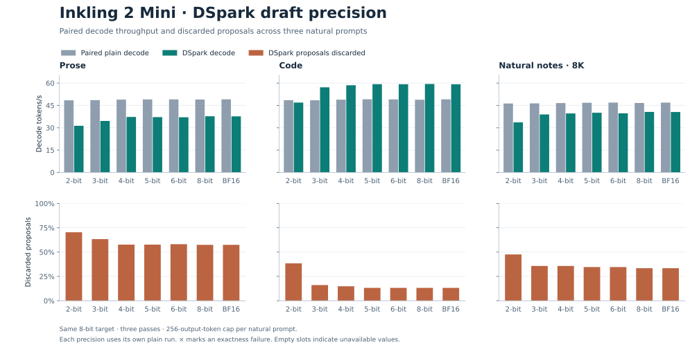

# Inkling 2 Mini · DSpark draft precision on M5 Max



The 8-bit draft ran the short code prompt at **59.4 tok/s** against **48.9 tok/s** with plain decoding.
It slowed prose from 49.0 to 37.7 tok/s and 8K notes from 46.6 to 40.6 tok/s.
All 21 prompt and precision pairs matched the plain token sequence and finish reason.
DSpark remained disabled in production.

| Draft | Short prose (tok/s) | Short code (tok/s) | 8K notes (tok/s) |
| --- | ---: | ---: | ---: |
| [2-bit](draft-2.json) | 48.4 → 31.3 | 48.5 → 46.9 | 46.3 → 33.6 |
| [3-bit](draft-3.json) | 48.6 → 34.6 | 48.5 → 57.2 | 46.4 → 38.9 |
| [4-bit](draft-4.json) | 48.9 → 37.3 | 48.9 → 58.5 | 46.6 → 39.6 |
| [5-bit](draft-5.json) | 49.0 → 37.1 | 49.1 → 59.3 | 46.8 → 40.1 |
| [6-bit](draft-6.json) | 49.0 → 37.0 | 49.1 → 59.2 | 46.9 → 39.7 |
| [8-bit](draft-8.json) | 49.0 → 37.7 | 48.9 → 59.4 | 46.6 → 40.6 |
| [BF16](draft-16.json) | 49.1 → 37.6 | 49.1 → 59.2 | 46.9 → 40.6 |

Each cell reads plain → DSpark. The three prompts have 49, 56, and 8,192 input tokens after the native
chat template. Each precision had one measured plain and one measured draft attempt per prompt with fresh
KV after a short exactness warmup. Generation was greedy with seed 1234, reasoning effort `none`, and EOS
stopping enabled under a 256-token cap. Every measured run reached the cap. These measurements cover
throughput and token identity on this three-prompt set. They contain no task quality scores.

The target stays at 8-bit with three passes and 48 layer visits across all trials. The drafter runs
a bidirectional transformer over an eight-position block. With `--trim-head`, the vocabulary and
Markov heads emit only the guesses the verifier needs, up to three per round. The target processes
up to four positions per verification round, comprising the current anchor and those guesses.
The 2- to 8-bit variants use group-size-64 affine quantization for the drafter's layer linear
projections. BF16 is the original draft precision.

The discard rate is the fraction of emitted guesses outside the accepted prefix. It includes the
first mismatch and the emitted guesses after it. The target supplies the anchor and any bonus
token. The 8-bit draft discarded 57.5% on prose, 13.2% on code, and 33.5% on 8K notes.
Code benefited at several precisions. Both other prompts ran slower across the sweep.

## Environment

- Apple M5 Max with 64 GiB unified memory.
- MLX 0.32.4 and MLX-LM revision [`0c4c99192230f1943dd468d297f0b8a64ae7b7c2`](https://github.com/ml-explore/mlx-lm/commit/0c4c99192230f1943dd468d297f0b8a64ae7b7c2).
- TensorFold plain worker base `75ab61b9c24d672858a86eb54323c8423ca16202`.
  Each receipt includes the SHA-256 of that base's `request_state.py`.
- 8-bit target `araysuter/Inkling-2-Mini-MLX-8bit`, revision [`ececf5ebe6175372addee86a260addaa5537ac55`](https://huggingface.co/araysuter/Inkling-2-Mini-MLX-8bit/tree/ececf5ebe6175372addee86a260addaa5537ac55).
- Original draft `mtp.safetensors`, revision `6e7c8248f75265bdd4fbab5273304243b5d8c2cb`. [Thinking Machines checkpoint](https://huggingface.co/thinkingmachines/Inkling-2-Mini).
  The [vendor notice](../../tools/inkling/dspark_bench/NOTICE) identifies the Apache-2.0 draft adapter source.
- The receipts record minimum available system memory of 13.04–13.54 GiB and per-run maximum MLX
  allocator peaks of 34.28–34.72 GB. MLX allocator peaks use decimal GB. The free-plus-inactive
  system memory metric uses binary GiB.

## Reproduce

Create the pinned environment in the [Inkling worker setup](../../tools/inkling/README.md).
Run from the checkout containing this benchmark and set `INKLING_ENV`, `MODEL_DIR`, `DRAFT_DIR`,
`WORKER_BASE_DIR`, and `RESULTS_DIR` to local directories. Choose a new directory for the worker base
worktree. Use an idle M5 Max for the paired runs. The reproducer checks for 32 GiB available before loading
and stops at an 8 GiB floor.

```sh
git worktree add --detach "$WORKER_BASE_DIR" 75ab61b9c24d672858a86eb54323c8423ca16202
"$INKLING_ENV/bin/hf" download araysuter/Inkling-2-Mini-MLX-8bit \
  --revision ececf5ebe6175372addee86a260addaa5537ac55 --local-dir "$MODEL_DIR"
"$INKLING_ENV/bin/hf" download thinkingmachines/Inkling-2-Mini mtp.safetensors \
  --revision 6e7c8248f75265bdd4fbab5273304243b5d8c2cb --local-dir "$DRAFT_DIR"
export MLX_ENABLE_TF32=0 MLX_METAL_FAST_SYNCH=1 MLX_MAX_OPS_PER_BUFFER=200 MLX_MAX_MB_PER_BUFFER=200

for bits in 2 3 4 5 6 8 16; do
  "$INKLING_ENV/bin/python" tools/inkling/bench_dspark_quantization.py \
    --model "$MODEL_DIR" --draft "$DRAFT_DIR/mtp.safetensors" \
    --source "$PWD/tools/inkling" --worker-source "$WORKER_BASE_DIR/tools/inkling" \
    --long-prompt --tokens 256 --width 8 --verify-width 4 --draft-bits "$bits" \
    --cache-projected --trim-head --device-markov \
    --output "$RESULTS_DIR/draft-${bits}.json" || break
done
```

The [reproducer](../../tools/inkling/bench_dspark_quantization.py) compares the experimental verifier
with the [worker reference](../../tools/inkling/dspark_reference.py) using fresh request state,
512-row prefill chunks, and logprobs off. Timings are taken directly in the process. A token or
finish-reason mismatch exits nonzero.

With Matplotlib 3.11.2, regenerate `draft-precision.svg` from the new receipts.

```sh
python3 benchmarks/inkling-dspark-2026-11-21/plot.py "$RESULTS_DIR"
```
