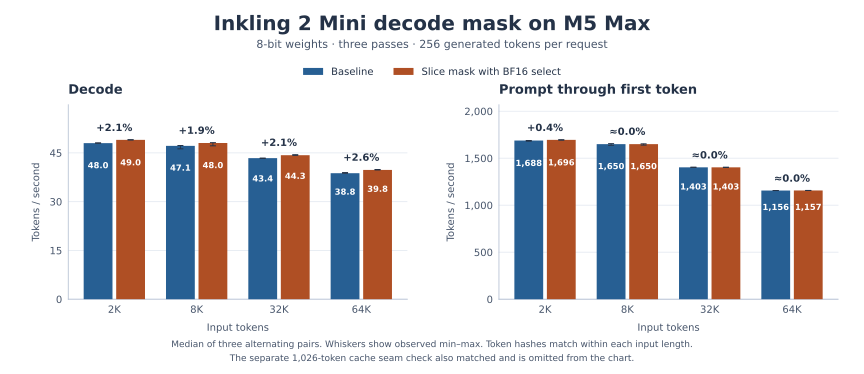

# Inkling 2 Mini decode mask on M5 Max



The exact mask path improved median greedy decode by 1.9–2.6% on this M5 Max. Prompt throughput
stayed effectively unchanged. The checkpoint weights, three passes and sampling implementation are unchanged.

| Input tokens | Baseline decode | Mask decode | Change | Mask prompt throughput |
| --- | ---: | ---: | ---: | ---: |
| 2,000 | 48.00 tok/s | 49.00 tok/s | +2.1% | 1,696 tok/s |
| 8,000 | 47.15 tok/s | 48.03 tok/s | +1.9% | 1,650 tok/s |
| 32,000 | 43.38 tok/s | 44.29 tok/s | +2.1% | 1,403 tok/s |
| 64,000 | 38.75 tok/s | 39.75 tok/s | +2.6% | 1,157 tok/s |

The in-process benchmark switches between upstream attention and the worker's slice mask on the same loaded 8-bit checkpoint. Both modes use MLX 0.32.4, the same three loop passes, 512-token prefill chunks, seed 1234, greedy decoding, and a fresh KV cache for each request. Each run emits 256 tokens. The harness alternates baseline-first and mask-first order and verifies generated token IDs against the first run at each input length. [8K receipt](mask-head-eight-k.json) · [Other lengths and seam receipt](mask-head-contexts.json)

Prompt throughput divides input tokens by the time from starting request advancement to the first emitted token. Decode throughput divides the 255 intervals between emitted tokens by the time from the first token to the last. The figure shows per-mode medians across three repeats, observed min–max ranges, and relative changes in the medians. The receipts also contain the 1,026-token cache seam check. These timings cover the in-process request path.

## Reproduce

From the repository root on an otherwise idle Apple M5 Max, use the tested worker source and an isolated Python environment. Set `MODEL_DIR` to a local snapshot of `araysuter/Inkling-2-Mini-MLX-8bit` at revision `ececf5ebe6175372addee86a260addaa5537ac55`. Set `RECEIPT_DIR` to the directory containing this README and `plot.py`.

```sh
git worktree add --detach .inkling-mask-source e8cf064f019136147f9c215445d6ea1410e86955
python3 -m venv .venv-inkling-mask
.venv-inkling-mask/bin/python -m pip install 'mlx==0.32.4' \
  'git+https://github.com/ml-explore/mlx-lm.git@0c4c99192230f1943dd468d297f0b8a64ae7b7c2' matplotlib

export MLX_ENABLE_TF32=0 MLX_METAL_FAST_SYNCH=1
export MLX_MAX_OPS_PER_BUFFER=200 MLX_MAX_MB_PER_BUFFER=200

run_mask_bench() {
  .venv-inkling-mask/bin/python .inkling-mask-source/tools/inkling/bench_decode_mask.py \
    --model "${MODEL_DIR:?Set MODEL_DIR to the pinned checkpoint directory}" \
    --worker-source .inkling-mask-source/tools/inkling \
    --base-commit 75ab61b9c24d672858a86eb54323c8423ca16202 \
    --head-commit e8cf064f019136147f9c215445d6ea1410e86955 \
    --model-revision ececf5ebe6175372addee86a260addaa5537ac55 \
    --lengths "$1" --output "${RECEIPT_DIR:?Set RECEIPT_DIR to the receipt directory}/$2"
}

run_mask_bench 8000 mask-head-eight-k.json
run_mask_bench 1026,2000,32000,64000 mask-head-contexts.json
.venv-inkling-mask/bin/python "$RECEIPT_DIR/plot.py"
```

The benchmark checks the 8 GiB available-memory floor and uses a 48 GiB MLX memory limit with a 256 MiB allocator cache. The plotter verifies the paired receipts, including the seam, before writing `speed.svg` and `speed.png`.

## Qualification

The measured code is `e8cf064f019136147f9c215445d6ea1410e86955`, compared with
`75ab61b9c24d672858a86eb54323c8423ca16202`. Receipt source hashes identify the runtime files;
subsequent receipt and comment edits do not change them. Hardware was an Apple M5 Max with 64 GiB
RAM and macOS 27.0.1. This optional MLX worker is separate from the native Zig engine.

[Checks](checks.json) record 28 passing worker tests with zero skips and two planted failures caught by
the tests. The mask test covers all 65,536 BF16 encodings in 11 dense/rotating layouts, retaining the
stock select's subnormal and NaN behavior. Whole SDPA outputs match at cache boundaries through
131,072 keys and after a real rotating-cache spill and write. Unsupported chips, runtimes, shapes,
and dtypes retain the upstream implementation. No new GPU kernel or reduction is introduced.

The isolated gateway accepted two simultaneous sampled text requests in both streaming modes;
each matched its solo answer and [generated-token hash](api-hashes.json). The hash fixture asks
“Explain why hash tables can have collisions in two sentences.” with temperature 0.7, seed 1234,
and a 96-token output cap. Images, selected and top-three log probabilities, and the
[tool round-trip checks](api-tools.json) passed. These are protocol and exactness checks, not quality scores.
The existing 128K limit, two-text/one-image concurrency, and 8 GiB host reserve are unchanged.

Minimum free-plus-inactive system memory was 12.68 GiB. The
[physical-memory observation](mask-physical-memory.json) records a kernel lifetime peak of 33.98 GiB
for the process performing the alternating context tests, sampled during its final 64K pairs.
Per-run MLX allocator peaks are in the raw receipts. Other Apple chips, CPU execution, CUDA and HIP
were not device-qualified; the optimization is restricted to the pinned M5 Max runtime.
