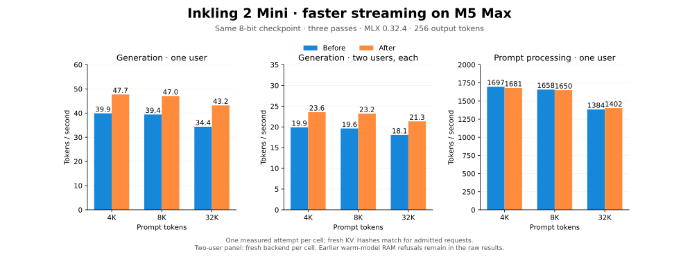

# Inkling 2 Mini: streaming overlap on M5 Max



The worker previously read a selected probability from the GPU for every token,
even when the response did not include probabilities. The read queued an extra
indexing operation and CPU wait behind the prefetched next token. Now that
read occurs only when requested. Requested selected/top log probabilities keep
the original path. The M5 deployment also uses MLX's fast synchronization and
200-operation/200-MB command-buffer controls; the worker's defaults for other
hardware are unchanged.

This uses the **same 8-bit weights, three passes and 48 logical layer visits**.
There is no lower-precision mode, smaller KV cache, reduced context limit or new
GPU kernel. MLX remains 0.32.4 and the Inkling port remains
`0c4c99192230f1943dd468d297f0b8a64ae7b7c2`. Target:
[`araysuter/Inkling-2-Mini-MLX-8bit`](https://huggingface.co/araysuter/Inkling-2-Mini-MLX-8bit),
weight revision `ececf5ebe6175372addee86a260addaa5537ac55`.
Base TensorFold: `f143293285e19cf62bbc90fcee97f0a66505135f`; candidate is the
commit containing this receipt.

## Served measurements

M5 Max, 64 GiB, macOS 27.0.1; one measured attempt per cell, fresh KV, seed 1234,
greedy decoding, 256 output tokens. The isolated benchmark forces the output
budget for consistent timing. The public serving profile respects EOS.
Prompts are deterministic token arrays from the existing benchmark tool; these
are speed and token-identity checks, not quality scores or task completion times.

| Context | Solo generation before → after | Solo prompt processing before → after |
| --- | ---: | ---: |
| 4K | 39.9 → 47.7 tok/s | 1,697 → 1,681 tok/s |
| 8K | 39.4 → 47.0 tok/s | 1,658 → 1,650 tok/s |
| 32K | 34.4 → 43.2 tok/s | 1,384 → 1,402 tok/s |

Generation improved about 20–26%; prefill differences are small (−0.9% to
+1.3%) and no material prefill gain is claimed. In the initial matched admitted
4K pair, per-user generation improved 19.8 → 23.5 tok/s.

Raw initial matrices: [before](baseline.json), [after](optimized.json).
[Telemetry](telemetry.json) records zero swap growth and the physical backend
footprint. Every solo oracle and admitted comparable output matched across
sources. Each admitted concurrent output matched its own solo/plain oracle.

The initial warm-model matrix includes second-request HTTP 503 refusals: before
at 32K and after at 8K. Their `capacity_limited` status is retained; an admitted
single reply is not a two-user measurement. The guard reserves room for a full
128K window per admitted user, independent of these shorter test inputs.
Fresh-backend two-user trials are recorded separately in
[fresh-pairs.json](fresh-pairs.json). All six pairs admitted both users and
matched their solo oracles. The figure uses
those matched fresh-backend trials for its two-user panel. Neither the 8 GiB
reserve nor the 4.5 GiB per-user working allowance was relaxed. These are not
new two-full-128K capacity or long-context accuracy measurements.

| Context | Two users, each: before → after |
| --- | ---: |
| 4K | 19.9 → 23.6 tok/s |
| 8K | 19.6 → 23.2 tok/s |
| 32K | 18.1 → 21.3 tok/s |

These matched fresh-start pairs improve per-user generation about 18–19%.

To reproduce each isolated benchmark profile:

```sh
python3 tools/bench_studio_concurrency.py http://127.0.0.1:8082 inkling-2-mini \
  --lengths 4000,8000,32000 --levels 1,2 --context 131072 --tokens 256 \
  --api-key-env TENSORFOLD_API_KEY --output result.json
```

Use an owned isolated gateway and the benchmark-only worker flag; never enable
that flag on the public API. Run base with its existing environment, then the
candidate with the [M5 settings](../../tools/inkling/README.md#m5-max-streaming-tuning).
For the fresh-backend two-user cells, start a new owned gateway/backend for each
context length, send both requests together, and compare their hashes with the
same solo oracles. Do not run competing inference during these measurements.

## Screening and rejected options

[Screening data](screening.json) retains 19 runs/configurations, including the
baseline repeat and one failed compiler experiment. The smaller screen uses
128 output tokens; do not substitute those numbers for the served 256-token
matrix. It covers fast synchronization, command-buffer sizes, greedy RNG
bookkeeping, larger allocator cache, wired memory, prefill chunks, message-gate
projection merging/compilation, a bounded global-prefill SDPA route and a newer
MLX source build.

- MLX development build `777d74171952d1fd99c664a63b692fa4a4183a5d` did not give a
  useful generation gain and changed two prompt-cell token hashes. It stays in
  an isolated test environment. The installed stable release was already
  [MLX 0.32.4](https://github.com/ml-explore/mlx/releases/tag/v0.32.4).
- 1,024-row prefill changed two token hashes. The 512-row serving path remains.
- 1,000-operation/MB buffers slightly improve decode over 200 but slow prefill;
  the balanced 200/200 profile is selected.
- Larger allocator cache, wired memory, greedy RNG changes, and message-gate
  merging did not provide a useful generation gain. Gate sample oracles used
  BF16/FP32 inputs, not general FP32/FP32 qualification. They are not shipped.
- Message-gate compilation was slower. Combined merge/compilation failed MLX's
  shapeless `Split` shape inference and was not deployed.
- A bounded global-prefill SDPA trial, inspired by
  [oMLX's M5 strategy](https://github.com/jundot/omlx/blob/ade9f20a43a8aa8d9191f6c6f130a98154306405/omlx/patches/inkling2/kernels.py#L323),
  retained these greedy hashes but was slower, especially at 32K. This is not
  a reason to force every operator onto a tensor-unit matrix path.

MLX detects `applegpu_g17s` and selects supported M5 Metal/NAX matrix paths.
GPU counters sampled during the screen reported 100% device utilization; this
is not a measurement of every neural accelerator's occupancy. Low Power Mode
was off. No GPU architecture override or reduced FP32 precision was enabled.

## Drafter on natural prompts

The [separate DSpark probe](natural-dspark.json) uses native chat formatting,
BF16 draft projections, eight drafted/four verified positions, EOS stopping,
and three prose/code tasks capped at 256 tokens. All reached that cap; these
are not completed-task quality benchmarks. All paired target tokens matched.

| Task | Plain tok/s | DSpark tok/s | Proposed tokens discarded |
| --- | ---: | ---: | ---: |
| Short prose | 40.3 | 34.4 | 57.5% |
| Short code | 40.5 | 54.3 | 13.2% |
| Natural notes, 8K | 38.8 | 36.1 | 33.5% |

The [natural-prompt probe](../../tools/inkling/bench_natural_dspark.py) uses the
existing Apache-2.0 draft adapter and pinned runtime. With local checkpoint and
bundled draft paths, reproduce it in the qualified environment:

```sh
python tools/inkling/bench_natural_dspark.py \
  --model "$MODEL_DIR" --draft "$DRAFT_DIR/mtp.safetensors" \
  --source "$PWD/tools/inkling" --tokens 256 --width 8 --verify-width 4 \
  --draft-bits 16 --long-prompt --output natural-dspark.json
```

Discard includes unverified suffixes after the first mismatch. These few tasks
are not a general acceptance-rate estimate. The drafter helps the code probe
but regresses the others, so it remains disabled in the general API. No public
fixed-three-pass 125 tok/s implementation was reproduced.

## Validation scope

The new readback regression has three failing assertions on the base and passes
with the change. It covers ordinary responses, requested selected probabilities
and preservation of the top-probability formatter. All 21 worker tests pass in the pinned MLX environment, including the existing
seeded/interleaved state tests. The gateway suite has 71 passing tests and the
protocol checker's negative control passes. Lean counts are 221 inherited on
base/head with zero new findings. No Zig/native arithmetic or kernel changed;
those builds and other chips/backends were not rerun. Speed figures are
single-attempt observations; the repeat baseline is retained in screening data.
