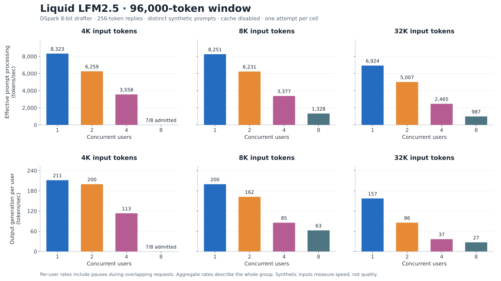
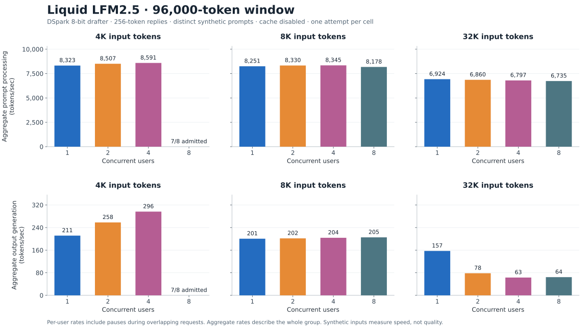

# Liquid 96K concurrency receipt

Apple M5 Max, 64 GiB unified RAM. One attempt per cell, 256 output tokens, cold synthetic token arrays, temperature 0, seed 1234. No quality claims. Input and output share a 96,000-token window.

Runtime: `2d5af28e8e82941cbfc261a9694a3dbafa54cca3`, DSpark 8-bit; gateway executable code: `f9f3667d5d26edde5fa8d62ee11539a94d664997`. Exact target/drafter revisions and per-stream hashes are in [results.json](results.json). Build and configuration: [Liquid guide](../../../../tools/studio-gateway/LIQUID.md).

The 24 plain solo references completed. All 44 completed drafted requests matched their reference tokens. One request in the 4K/eight-user burst received HTTP 503 from RAM admission; that cell is 7/8 admitted, not an eight-user speed measurement. The benchmark correctly exited 2 (`capacity_limited`). Eight users completed at both 8K and 32K; their decode intervals overlap. The profile ceiling is eight, with an 8 GiB host reserve; actual admission adapts to available RAM.

| Input tokens | Attempted users | Completed | Median effective prompt tok/s | Median generation tok/s/user | Aggregate generation tok/s |
| ---: | ---: | ---: | ---: | ---: | ---: |
| 4,000 | 1 | 1 | 8,323 | 211.4 | 211.5 |
| 4,000 | 2 | 2 | 6,259 | 199.7 | 258.2 |
| 4,000 | 4 | 4 | 3,558 | 113.4 | 296.4 |
| 4,000 | 8 | 7 | n/a | n/a | n/a |
| 8,000 | 1 | 1 | 8,251 | 199.6 | 200.5 |
| 8,000 | 2 | 2 | 6,231 | 162.3 | 201.7 |
| 8,000 | 4 | 4 | 3,377 | 85.4 | 203.8 |
| 8,000 | 8 | 8 | 1,328 | 62.6 | 205.4 |
| 32,000 | 1 | 1 | 6,924 | 157.2 | 157.2 |
| 32,000 | 2 | 2 | 5,007 | 85.6 | 78.3 |
| 32,000 | 4 | 4 | 2,465 | 36.6 | 63.0 |
| 32,000 | 8 | 8 | 987 | 27.2 | 64.5 |

Effective prompt rate is input tokens divided by client-observed time to first token, including scheduling waits. Native prefill duration is also retained in the raw rows. Generation rates include stalls while other users prefill. Aggregate output rate counts generated tokens between the group’s first and last output tokens; end-to-end throughput is a separate field. Median rates do not add to group throughput. These synthetic inputs are not representative prose and can have very different speculative acceptance from real tasks.

Reproduce with the command in the Liquid guide; regenerate charts with `python3 plot.py results.json output-directory` in a Matplotlib environment. The CSV includes measured successful-subset rates for the 7/8 cell; do not label those as eight-user throughput.

The [raw baseline](baseline.json) from the same machine’s pre-port whole-prompt build measured 11.9 tok/s median per user and 54.0 tok/s aggregate output at 32K/eight users. The final stepped run measured 27.2 and 64.5 respectively. That is about 2.3x median per-user output and 1.19x aggregate output in this single synthetic trial; it is not a universal speedup guarantee.

Platform scope: M5 Max Metal only. Other chips, CUDA, HIP and Windows are not device-qualified by this receipt. Host suites and known golden differences are separate from these real-checkpoint token-equality checks.

[Full-window capacity and cancellation evidence](capacity.json): eight requests of
95,000 input plus 64 output tokens completed with hashes equal to the earlier
whole-prefill baseline. Sampled engine footprint peaked near 28.8 GiB, with at
least 18.3 GiB available and unchanged swap during that capacity run. This does
not prove eight idle full histories remain resident after all replies; stateless
requests release their state. A cancelled stream left its peer running.

A subsequent artificial host-allocation stress probe was stopped by the watchdog
after it grew swap by about 1.2 GiB. Its buffers were released and the previous
API restored. That failed probe is retained in the receipt and is not counted
as a no-swap success. Admission cannot stop an unrelated process from allocating
RAM after a request is admitted. The replacement admission check uses a larger
conservative per-user configuration to verify two HTTP admissions and a third
RAM refusal without allocating a host pressure buffer.

The [reservation probe](admission.json) passed: two active users, third request
HTTP 503 / `insufficient_memory`, recovery after cancellation, unchanged swap.
The deliberately conservative probe budget was 11.504 GiB/user; production
retains its measured 2.875 GiB/user budget and 8 GiB host reserve.
